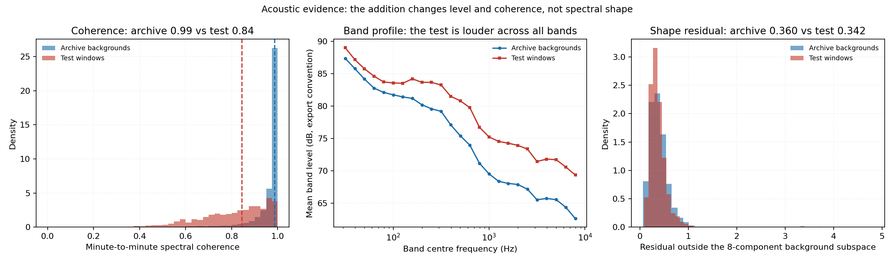
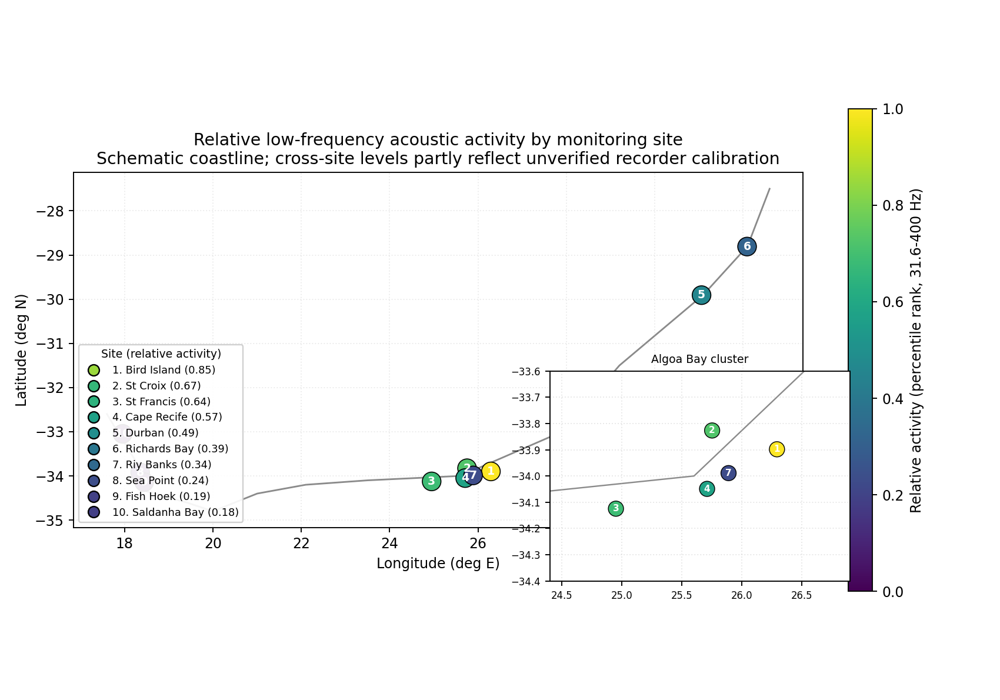

# Detecting controlled vessel-passage additions in South African hydrophone records

Code and research write-up for the **Zindi — Underwater Vessel Noise Challenge**
(French Embassy in South Africa).

Team entry: **RubenPA** · public leaderboard **0.7861** · write-up: [`WRITEUP.pdf`](WRITEUP.pdf) / [`WRITEUP.md`](WRITEUP.md)

## What this is

The challenge gives 1.7 M unlabelled one-minute acoustic records from ten South
African hydrophone sites and a test set of 1,500 windows built by adding a
**recorded vessel passage** to a real background. The target is the fraction of
the window's energy contributed by that controlled addition (`share_added_vessel`),
scored as `1 − RMSE`.

We built synthetic training mixtures from VTUAD (the corpus named in the starter
notebook's licence cell) mixed with the released backgrounds, trained a gradient
boosting model on 146 acoustic features, and calibrated the output against the
public benchmark.



## Three findings

1. **The target is effectively two-valued.** The public benchmark is a constant
   0.2461 scoring 0.7539 (RMSE equal to its own prediction). For a two-point
   target `{0, k}` that identity holds if and only if `k = 2c = 0.4922`,
   independently of how often an addition is present — so half the task is a
   presence decision, not a magnitude estimate.
2. **The addition does not change the spectral shape.** Projected on an
   8-component subspace fitted on 28,055 background spectra, test windows are
   indistinguishable from archive windows (residual 0.342 vs 0.360). Shape-only
   features therefore saturate at a real correlation of ρ ≈ 0.5.
3. **The prediction is invariant to the reference library.** Rebuilding the
   references from 508 strict-interval clips instead of nine padded class
   archives changes the predictions by 0.04 on a standard deviation of 0.18
   (ρ = 0.95). The model is reading a property of the window — temporal
   variability around 3 kHz, 62 % of its gain — not the passage.

The write-up argues all three with numbers, including the negative results: an
AIS cross-check that comes out **negative** (ρ = −0.41 between our activity index
and vessel traffic), and a relative-activity map we explicitly decline to call a
pressure map.



## Repository layout

| Path | Contents |
|---|---|
| `WRITEUP.pdf` / `WRITEUP.md` | Research write-up |
| `figures/` | Five figures used in the write-up |
| `src/` | Full pipeline: windows, references, training, calibration, analysis |
| `tests/` | 28 unit tests for the target definition and the mixture builder |
| `requirements.txt` | Pinned dependency versions |

## Data (not redistributed)

1. **Competition files** from the Zindi Data tab: `Test.csv`,
   `sample_submission.csv`, `South_African_Real_Acoustics.zip` → place in `data/`
   and run `python -m src.extract_archive`.
2. **VTUAD (rebuilt) v1.3.2**, CC BY 4.0 — https://doi.org/10.5281/zenodo.23037895
   → per-class archives or `vtuad_strict_wav_vessel.zip` in `data/vtuad/`.

The South African measurements are not redistributed here; they remain under the
challenge's data-use terms.

## Reproduce

```bash
python -m src.extract_archive        # unpack the South African archive
python -m src.build_windows          # 28,055 background windows (8 sites)
python -m src.train_passage --vtuad-strict data/vtuad/vtuad_strict_wav_vessel.zip \
    --samples 40000 --learning-rate 0.1 --rounds 1500 --early-stopping 100 \
    --zeros 0.5 --share-min 0.44 --share-max 0.54 --out submission.csv
python -m src.recalibrate --input submission.csv --mean 0.2461 --alpha 0.783
python -m src.validate_submission submission.csv
python -m unittest discover -s tests -t .    # 28 tests
```

Analysis and figures:

```bash
python -m src.pressure_map        # activity map and monthly panel
python -m src.ais_density         # AIS cross-check (queries the GMTDS public WMS)
python -m src.evidence_figures    # coherence, band profile, PCA residual
python -m src.feature_importance  # what the model actually uses
```

**Runtime.** Python 3.10, CPU only. Training: 40,000 mixtures × 146 features,
eight leave-one-site-out folds, about 10 minutes on a 12-core laptop. Inference on
1,500 windows: under a second.

## External data declared

- **VTUAD (rebuilt) v1.3.2**, Zenodo `10.5281/zenodo.23037895`, CC BY 4.0, public
  download. Upstream audio: Ocean Networks Canada, Oceans 3.0. Converted to
  minute-level band power with the starter notebook's `minute_band_power`; absolute
  digital gain discarded.
- **GMTDS** (Global Maritime Traffic Density Service, MapLarge/NGA), public OGC
  WMS at `https://gmtds.maplarge.com/ogc/wms`, layer `ais:density`. Used **only**
  for the independent control, never as a training feature.

`Test.csv` was used for inference only.
