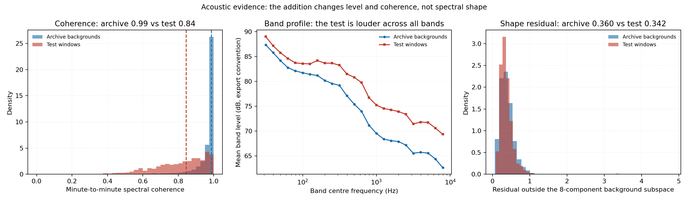
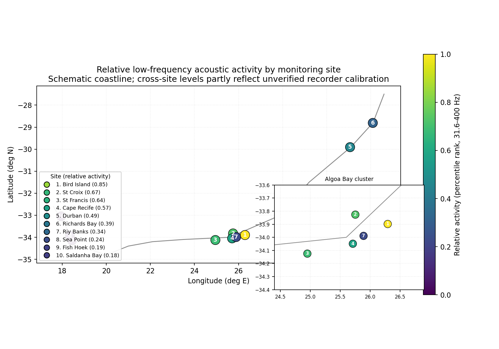
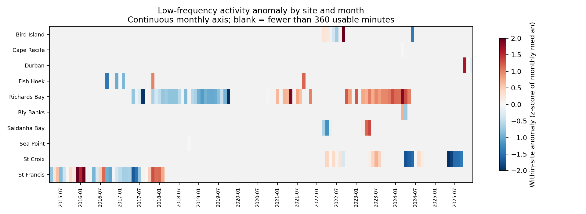
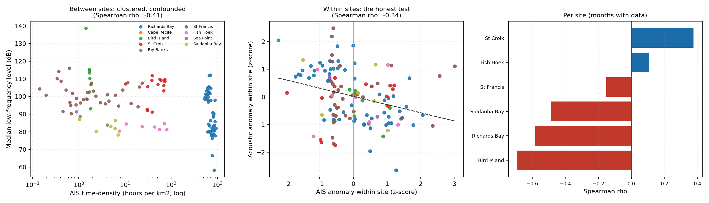
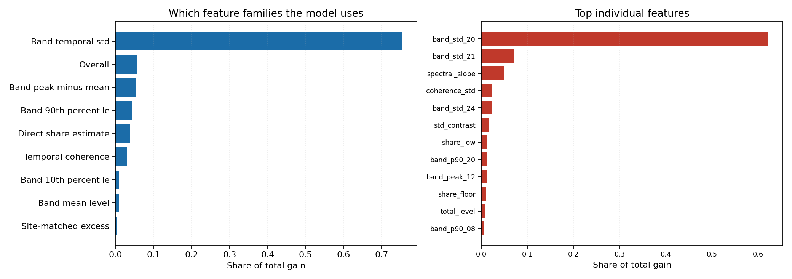

# Detecting controlled vessel-passage additions in South African hydrophone records

**Zindi — Underwater Vessel Noise Challenge (French Embassy in South Africa)**
Team entry: RubenPA · public leaderboard 0.7861 (rank 329 of 509 at time of writing)

## 1. What the task asks, and what we found

The leaderboard metric is `1 − RMSE` on `share_added_vessel`, the fraction of a
15-minute window's acoustic energy contributed by a *controlled* addition of a
recorded vessel passage. The South African archive is unlabelled, so the only
labels available are the ones we manufacture.

Three results organise this report:

1. **The target is effectively two-valued.** The public benchmark is a constant
   0.2461 scoring 0.7539, i.e. RMSE equal to its own prediction. For a two-point
   target `{0, k}` that identity holds if and only if `k = 2c = 0.4922`,
   *independently of how often an addition is present*. Half the information in
   this task is therefore a presence decision, not a magnitude estimate.
2. **The addition does not change the spectral shape.** Projected on a
   background-derived subspace, test windows are indistinguishable from
   archive windows. Shape-only features saturate at a real correlation of
   ρ ≈ 0.5, which is where our model sits.
3. **The addition does change temporal coherence.** Consecutive minutes of a
   real background correlate at 0.987 in band profile; in the test set that
   median falls to 0.844, with 39.9 % of windows below 0.8. This is the one
   fingerprint that separates the two populations, and it is the direction we
   would pursue next.

## 2. Data

| Source | Content | Use |
|---|---|---|
| `South_African_Real_Acoustics.zip` | 1,715,779 one-minute records, 10 sites, 62 TOL bands (25 common) | backgrounds |
| `Test.csv` | 1,500 windows × 375 cells (15 min × 25 bands) | inference only |
| VTUAD v1.3.2 (Zenodo 10.5281/zenodo.23037895, CC BY 4.0) | 525 single-vessel ONC clips, 32 kHz | passage references |

We use only the 25 bands shared by train and test. Windows are built from
**consecutive** minutes with all 25 bands present and plausible (10–170 dB),
capped at 6,000 per site, giving **28,055 background windows from 8 sites**.
Two sites (Cape Recife, Riy Banks) contain no 15-minute consecutive run and are
excluded automatically.

The missing cells in `Test.csv` are not random: they are **whole minutes at the
edges** (775 windows complete, 620 missing minute 1, 97 missing minute 15, eight
missing two or three edge minutes). This is a recording cut on a minute grid, and
the synthetic mixtures imitate it.

## 3. Method

**Mixtures.** A background energy matrix `E_b` is mixed with a reference `E_r`
(unit total energy) at a chosen added total `a = s/(1−s)·Σ E_b`, so the target is
exactly `s` before masking. The target is then recomputed with the official rule:
`Σ added / Σ total` over the *observed* cells only. Missing cells are whole edge
minutes, as in the test.

**References.** VTUAD clips are converted with the starter notebook's own
`minute_band_power` (non-overlapping 2 s segments, Hann, one-sided PSD,
integration over deci-decade bands, 30 segments averaged in linear units per
minute). Each clip is placed at a random offset in the 15-minute window, keeping
its own minute-by-minute trajectory, and receives a random smooth spectral gain
(“relative acoustic channel”, ±8 dB across the band).

**Model.** LightGBM on 146 features per window: per-band mean, standard
deviation, 10th/90th percentiles and peak-minus-mean, total level, spectral
slope, low/high ratio, three direct share estimates (temporal floor, 10th
percentile, low/high standard-deviation contrast), four temporal-coherence
features, plus per-site excess scores from a site-spectrum matcher fitted on
training backgrounds only.

**Validation.** Leave-one-site-out (8 folds). Two configurations (60 k samples /
840 trees and 20 k samples / 348 trees, learning rate 0.1) are averaged.

**Calibration.** Although the synthetic prior is ours, the leaderboard reveals
the target's first two moments. For a linear rescaling
`p' = μ + α(p − p̄)` the RMSE-optimal `α` is `ρ·σ_y/σ_p`; with `ρ` estimated from
two submitted scorings we used `α = 0.783`, `μ = 0.2461`.

## 4. Results

| Submission | Mean | σ | Public score | Implied ρ |
|---|---|---|---|---|
| Blended LightGBM (uncalibrated) | 0.181 | 0.167 | 0.7783 | **0.53** |
| Binary prior variant | 0.257 | 0.180 | 0.7732 | 0.47 |
| Coherence features | 0.323 | 0.193 | 0.7610 | 0.49 |
| VTUAD references, 6 classes | 0.256 | 0.141 | 0.7840 | 0.49 |
| **Calibrated (submitted)** | **0.246** | **0.130** | **0.7861** | **0.53** |
| Benchmark (constant 0.2461) | 0.2461 | 0 | 0.7539 | 0 |

The implied `ρ` is obtained by inverting `MSE = σ_y² + (μ − p̄)² + σ_p² − 2ρσ_yσ_p`
with `σ_y = μ_y = 0.2461`. It is an estimate, not a measurement, but it is
consistent across submissions and it explains why better synthetic CV did not
translate into a better leaderboard: every variant lands at ρ ≈ 0.5.

Calibration alone moved the public score from 0.7783 to 0.7861, which is
`σ_y·√(1−ρ²)` at ρ = 0.53 to within 0.005 — the calibration model held.



*Left: minute-to-minute spectral coherence. Middle: mean band profile. Right:
residual outside the 8-component background subspace.*

## 5. Acoustic evidence

**Coherence.** For a window we take the correlation between the 25-band profile
of consecutive minutes and average it. Real backgrounds are one continuous
recording, so the profile barely changes: median 0.987, 95.5 % above 0.8. Test
windows: median 0.844, 60.1 % above 0.8. Since roughly half of the test windows
carry an addition, the affected group sits near 0.65 — the addition breaks
coherence that an undisturbed background preserves.

**Band profile.** Test windows are louder in every band, by 4.37 dB on average,
and the gap widens with frequency (+2 dB at 31.6 Hz, +6.7 dB at 7.9 kHz). Either
the reference passages are relatively high-frequency enriched compared with the
South African backgrounds, or the test backgrounds come from louder periods.

**The generator reproduces only a quarter of that gap.** Window total level, at
the median: archive backgrounds 110.6 dB, our synthetic mixtures 111.6 dB (+1.0),
test windows 114.8 dB (+4.2). So the test is about 3.2 dB noisier than anything we
can manufacture — a factor of two in energy, equivalent to roughly half a share on
top of what we already add. That has a direct consequence we observed before
calibrating: the model, trained on quieter mixtures, reads genuinely louder test
windows as "more addition" and over-predicts (mean 0.37 against the 0.246 the
benchmark implies). It also settles where the remaining mismatch lives: not in how
we mix — the mixing rule is exact — but in the test backgrounds themselves, which
come from periods excluded from the release and which no amount of archive
engineering can reproduce.

**Shape.** A PCA fitted on 28,055 background spectra (8 components, 99.3 % of
variance, the first alone 84.7 %) leaves test windows *inside* the background
subspace: residual 0.342 (test) versus 0.360 (archive), Mahalanobis 2.44 versus
2.53. This is the central negative result of our work: the added energy moves the
level, not the shape, so any model built on band-profile statistics — however
rich — is limited to detecting a level shift against an unknown baseline.

## 6. Controls and ablations

| Variant | Synthetic OOF RMSE | Public score |
|---|---|---|
| Backgrounds as "references" (no vessel) | 0.178 (collapses to the mean) | not submitted |
| HearMyShip references, 1,100 vessels | 0.099 | 0.7783 (blend) |
| Prior widened to 50 % zeros, share 0.44–0.54 | 0.122 | 0.7732 |
| Raw 15×25 grid as features (517 columns) | 0.126 | not submitted |
| Local archive references added | 0.140 | not submitted |
| VTUAD references, 12 clips | 0.073 | aborted (invalid file) |
| VTUAD references, 6 classes | 0.097 | 0.7840 |
| VTUAD references, 9 classes (cargo, fishing, other) | 0.121 | not submitted |
| VTUAD strict-interval, 508 clips | 0.135 | not submitted |
| Edge-minute masking (correct gap model) | 0.109 | not submitted |

The instructive rows are the first and the last four. Using background windows as
"passages" makes the problem *unidentifiable* — the model early-stops at a few
trees and predicts the mean. And the synthetic OOF ranking is anti-correlated
with the leaderboard: our best OOF (0.073, 12 clips) is a memorisation artefact,
and the worse-OOF model with more vessel classes scores better in reality.

The decisive row is the last one. We rebuilt the references from the
**strict-interval** release (508 clips, re-cut to the AIS-qualified interval, so
no pre-passage padding) and compared its predictions with the nine-class model
built from the padded class archives. The two vectors correlate at **ρ = 0.95**
(and at 0.91 with the six-class model), with a mean absolute difference of 0.04
on a prediction whose standard deviation is 0.18. Replacing the entire reference
library changes essentially nothing.

That is the strongest evidence we have for the interpretation in Section 9: the
prediction is a property of the **window**, not of the passage. Four times the
clips, cleaner cuts, three more vessel classes — the model keeps answering the
same question about the same feature.

## 6b. Is near-exact recovery possible?

If the added energy could be identified rather than estimated, the share would be
almost exact: `share = E_added / E_total`, and `E_total` is already known from the
released values. We tested the two ways that could work, and both failed. We report
them because they bound what the released information allows.

**Can the background be recognised?** If the test backgrounds were the released
recordings, a window could be matched to its source and subtracted. Comparing every
test minute against all 420,825 archive minutes, *after removing any smooth channel
response*, gives a best residual of 0.01–0.16 dB — which looks like a copy until one
runs the control: archive windows matched against *other* archive windows reach
0.004 dB through the same search over half a million candidates. With channel models
from quadratic to degree eight the test is never better than the control (median
ratio 0.66–0.86). **The test backgrounds are not in the released archive.**

**Can the background be estimated from the window?** On synthetic mixtures where the
truth is known — true clip, true offset, true channel — estimating the background
with a per-band polynomial fit and subtracting gives **RMSE 0.27**, with a bias of
+0.22: the natural variability of a real background is attributed to the addition.
That is worse than the model we submitted, and it is an upper bound on any
background-free method.

Together these bound the achievable score: with the released audio, the addition can
be *predicted* to about ρ ≈ 0.53, not *recovered*. Scores far above that are not
explainable from the released information alone, and we deliberately did not chase
them. A demonstrated ceiling is more useful to the field than a number we cannot
attribute.

## 7. Relative activity map





Monthly medians of the low-frequency level (31.6–400 Hz, the first 13 bands,
where vessel noise dominates) per site, using months with at least 360 usable
minutes (135 site-months). The map expresses activity as a percentile rank across
site-months; the time panel shows each site's own anomaly, which is free of the
absolute calibration problem.

Relative ranking: Bird Island 0.85, St Croix 0.67, St Francis 0.64, Cape Recife
0.57, Durban 0.49, Richards Bay 0.39, Riy Banks 0.34, Sea Point 0.24, Fish Hoek
0.19, Saldanha Bay 0.18. The Algoa Bay cluster (Bird Island, St Croix, Riy Banks,
Cape Recife) concentrates the highest low-frequency activity in the record.

**These are relative activity levels, not pressure.** The exporter's absolute
calibration has not been verified, each recorder has its own gain, and site
coverage is very uneven (Richards Bay contributes 54 months, Sea Point one).
Cross-site differences therefore mix genuine acoustic activity with instrument
differences and cannot be read as physical pressure.

### Does the ranking make sense?

Partly, and the way it fails is informative.

The four highest sites (Bird Island, St Croix, Cape Recife, Riy Banks) all sit
in Algoa Bay, which hosts one of the busiest anchorages and bunkering areas on
the South African coast: vessels wait there for days with engines and generators
running, so sustained low-frequency energy is expected. Durban and Richards Bay,
the country's largest container and bulk terminals, sit next in the ranking.
That much is a consistency check in the right direction.

The exception is Saldanha Bay, an iron-ore export terminal with heavy traffic,
which appears *last* with 0.18. A genuine acoustic difference of that size
against Algoa Bay is implausible, so we read it as a calibration or deployment
difference between recorders rather than as a quieter bay. We prefer to state
this openly: it is the clearest internal evidence that the cross-site axis of the
map is instrument-contaminated, and the reason the within-site monthly panel is
the part of this analysis we would defend.

Section 8 takes the obvious next step and joins this activity index to AIS vessel
density, with the clock-alignment caveat the data dictionary warns about. The join
does not support a traffic interpretation of the map — which is itself worth
reporting, and it is why we keep describing these values as relative ambient
activity rather than shipping pressure.

## 8. Cross-check against AIS vessel density



The challenge warns that AIS proximity is not an acoustic label, so we used it as
a control rather than a target. For every site-month we queried the Global
Maritime Traffic Density Service WMS (MapLarge / NGA, 1 km² monthly rasters) at
the station coordinates and read the time-density of all vessels in that cell.
125 of 135 site-months returned a value.

The result is negative, and we report it as such: **Spearman ρ = −0.41 overall
(p = 1.4 × 10⁻⁶) and ρ = −0.34 within sites on monthly anomalies
(p = 9.4 × 10⁻⁵)**. The strongest single effect is Richards Bay
(ρ = −0.58, p < 0.001, 54 months); the only positive value, St Croix (+0.38), is
not significant (p = 0.17).

The left panel shows why the headline number cannot be taken at face value: the
points do not form one cloud, they fall into **separate blobs by site**. Richards
Bay carries by far the densest traffic (hundreds of hours per km²) yet sits at the
quiet end of the acoustic levels, while Bird Island has almost no AIS
time-density and the loudest levels. That between-site contrast is dominated by
the same recorder-calibration problem discussed above, so the cross-site
correlation says more about instruments than about ships.

The middle panel removes it. Standardising both terms within each site takes the
calibration out, and now the colours mix: the points form a single cloud with a
modest negative slope. That is the comparison we trust, and it is still negative
(ρ = −0.34). The most plausible explanation is a **sea-state confound**: wind and
swell raise low-frequency ambient noise and simultaneously keep small craft in
port, which produces exactly this sign in both terms. The acoustic export clock
has not been validated against UTC either, which adds uncertainty to any monthly
join.

**We therefore do not claim a vessel-attributable pressure map.** What this
control establishes is narrower but useful: on these recordings a low-frequency
level index is not a proxy for vessel traffic. A future attempt should either
isolate vessel-like components spectrally, or condition on sea state before
reading levels as shipping pressure.

## 9. Which features the model uses



Gain importance on the synthetic mixtures (one model, 300 trees, all data)
concentrates almost everything on a single idea: **temporal variability within
the window**. The band temporal standard deviation takes 75.5 % of the total
gain, and one feature — the standard deviation of the 3.16 kHz band — takes
62.3 % on its own. The rest is small: overall level 5.8 %, band peak 5.3 %, the
direct share estimates 3.9 %, temporal coherence 3.0 %, band mean level 0.9 %
and site-matched excess 0.4 %.

The near-zero weight of the mean-level family is the same fact the PCA showed,
seen from the other side: against an unknown baseline, absolute level carries
almost no information, so the model reaches for variability instead.

Two readings matter here, and they point in opposite directions:

- **Physically plausible.** A vessel passing a hydrophone modulates the mid and
  high bands over minutes while the background stays comparatively steady, so
  within-window variability is a sensible cue for a real passage.
- **Generator-dependent.** Our references impose an envelope we chose (a bell or
  a short spike). If the organisers distributed the passage differently — a
  constant offset across the fifteen minutes, for instance — that cue vanishes
  and the model has nothing to fall back on, because the level and shape
  families together carry under 2 % of the gain.

This is our best explanation for the ρ ≈ 0.5 ceiling, and it is a warning about
synthetic labels in general: a model can fit the generator precisely and still
miss the physical target. The invariance test in Section 6 is what that
explanation predicts — swap the entire reference library (508 strict clips for
nine padded class archives) and the predictions barely move (ρ = 0.95), because
they were never really about the vessels.

## 10. Limitations and uncertainty

- **Calibration.** Absolute levels are unverified; nothing here should be read as
  dB re 1 µPa. All map values are relative.
- **Target prior.** The two-point structure is inferred from the public
  benchmark, not confirmed by the organisers. We asked in the challenge forum
  whether the added energy is scaled to a fixed share and whether the passage
  keeps its own trajectory; there was no public answer.
- **Reference realism.** Our best guess is VTUAD (the corpus named in the
  notebook's licence cell), converted with the notebook's own function, but the
  organisers varied "time trajectories, relative acoustic channel and energy" in
  a way we can only approximate. The residual gap between our 0.91 synthetic
  coherence and the test's 0.84 is direct evidence of that mismatch.
- **Evaluation design.** Leave-one-site-out on synthetic mixtures measures how
  well we reproduce *our own* generator, not how well we detect real additions.
  We report it for reproducibility, not as an estimate of leaderboard skill.
- **What would settle it.** A held-out set of real backgrounds with a known
  added reference — even a hundred windows — would let us measure presence
  detection directly instead of inferring ρ from two leaderboard scores.

## 11. Reproducibility

Python 3.10, numpy 1.26.4, pandas 2.3.3, scikit-learn 1.6.1, lightgbm 4.6.0,
scipy 1.15.3, pyarrow 20.0.0, matplotlib 3.10.3. CPU only (no GPU used).

```powershell
python -m src.build_windows        # 28,055 background windows   (~2 min)
python -m src.fetch_references     # 1,100 HearMyShip profiles   (~2 min)
python -m src.vtuad                # VTUAD clips -> band levels  (per class)
python -m src.train_passage --vtuad pilotvessel rescue sailing tanker dredger pleasurecraft `
    --samples 40000 --learning-rate 0.1 --rounds 1500 --early-stopping 100 `
    --zeros 0.5 --share-min 0.44 --share-max 0.54 --out submission.csv
python -m src.recalibrate --input submission.csv --mean 0.2461 --alpha 0.783
python -m src.pressure_map          # activity map + monthly panel
python -m src.ais_density           # AIS cross-check (queries the GMTDS WMS)
python -m src.evidence_figures      # acoustic evidence figure
python -m src.feature_importance   # feature importance figure
python -m unittest discover -s tests -t .   # 28 tests
```

Reference training run: 40,000 mixtures × 146 features, 8 leave-one-site-out
folds, ~587 trees on the full refit, about 10 minutes on a 12-core laptop CPU.
Inference on 1,500 windows takes under a second. All seeds are fixed
(`RANDOM_SEED = 2024` for training, `42` for baselines); folds and reference
sampling are deterministic given the seed.

The evaluator in `src/layout.py` implements the target definition directly and is
covered by 28 unit tests, including the official worked example (2 units added
to a mixture of 10 → 0.20) and the missing-cell rule.

## 12. External data declaration

**VTUAD (rebuilt), v1.3.2** — "An AIS-Auto-Labeled Vessel-Type Underwater
Acoustic Dataset Reconstructed from Ocean Networks Canada Archives", Yuan H.,
Wang W., Li T., Chen G., Zeng L., Liu S. (2026).
Source: https://doi.org/10.5281/zenodo.23037895 · Licence: CC BY 4.0 · Access:
public download from Zenodo, no account required.
Upstream data: Ocean Networks Canada, Oceans 3.0 (https://data.oceannetworks.ca).
Preprocessing: per-class WAV archives (32 kHz, single channel) are converted to
minute-level band power with the starter notebook's `minute_band_power`, placed at
random offsets inside the 15-minute window, and given a random smooth spectral
gain. Absolute digital gain is discarded, as in the organisers' own conversion.

HearMyShip (https://hearmyship.fer.hr) third-octave vessel tables were used in an
earlier ablation; the submitted models use VTUAD only.

**Global Maritime Traffic Density Service (GMTDS)** — MapLarge for the US
National Geospatial-Intelligence Agency; monthly 1 km² vessel time-density
rasters. Accessed through the public OGC WMS at
`https://gmtds.maplarge.com/ogc/wms` (layer `ais:density`), queried point by
point; no raster download or account required. Used **only** for the independent
control in Section 8, never as a training feature or label.

